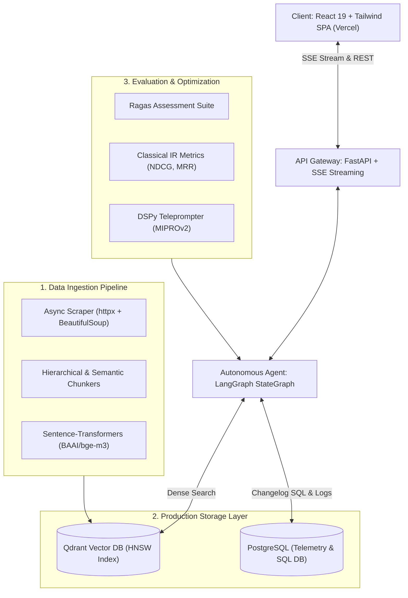

# 🎓 RAG Teacher (DevDocs AI Guide)

> **The ultimate interactive masterclass for building production-grade Retrieval-Augmented Generation (RAG) and Agentic systems from scratch.**

[](https://rag-teacher.vercel.app)
[](https://react.dev)
[](https://vitejs.dev)
[](https://tailwindcss.com)
[](https://python.org)
[](https://qdrant.tech)
[](https://langchain-ai.github.io/langgraph/)
[](https://dspy-docs.vercel.app)

---

## 🚀 Overview

**RAG Teacher** is an interactive, local-first educational platform and reference implementation designed to guide developers step-by-step through architecting, optimizing, evaluating, and deploying an autonomous documentation assistant (**DevDocs AI**).

Unlike toy RAG tutorials that stop at `RecursiveCharacterTextSplitter` and naive cosine similarity, this curriculum covers real-world production engineering:
- **Hierarchical (Parent-Child) & Semantic Breakpoint Chunking**
- **Two-Stage Retrieval** with Cross-Encoder Re-Ranking (`bge-reranker-large`)
- **Automated Component Evaluation** with Ragas (`Faithfulness`, `Context Precision`, `Context Recall`)
- **Classical IR Benchmarks** (`NDCG@K`, `MRR`, `Hit Rate@K`)
- **Autonomous Agent Workflows** with LangGraph (Multi-query search, Text-to-SQL, Corrective RAG)
- **Declarative Prompt Optimization** with DSPy (`MIPROv2` teleprompter compilation)
- **High-Performance Streaming UI** (SSE, React 19, citations drawer)

---

## 🏗️ System Architecture



---

## 📚 Masterclass Curriculum (28 Modules)

### Phase 1: Foundation & Data Pipeline
1. **Project Setup & Python Environment**: Modern workspace isolation using `uv` (Rust-based resolver) and `pyproject.toml`.
2. **Understanding the Corpus: MDN Web Docs**: Taxonomy, heading hierarchy, code density, and noise elimination.
3. **Building the Web Scraper**: Asynchronous polite scraper with `httpx`, `BeautifulSoup4`, and `markdownify`.
4. **Chunking Strategy 1: Fixed-Size**: Sliding window token chunking with `tiktoken` (`cl100k_base`).
5. **Chunking Strategy 2: Semantic**: Cosine distance breakpoint detection and Markdown heading-aware chunking.
6. **Chunking Strategy 3: Hierarchical**: Small child chunks (150 tokens) indexed for search linked to parent chunks (800 tokens) for LLM synthesis.
7. **Embedding with Sentence-Transformers**: Dense vector encoding with `BAAI/bge-m3` and L2 normalization.
8. **Setting Up Qdrant Vector Store**: Provisioning collections, HNSW graphs (`m=16`, `ef_construct=100`), and payload filtering.
9. **Basic Dense Retrieval**: Query embedding, cosine distance scoring, and top-$k$ candidate extraction.

### Phase 2: Retrieval Quality & Evaluation
10. **Cross-Encoder Re-Ranking**: Two-stage retrieval pipeline with `bge-reranker-large` to maximize precision.
11. **PostgreSQL Logging Layer**: Query telemetry, similarity scores, latency breakdown, and user feedback logs.
12. **SQL Changelog / Known Issues DB**: Hybrid RAG pairing vector search with deterministic SQL queries for version matrices.
13. **Creating a Golden Eval Set**: Curating 100+ ground-truth question-answer-context triplets.
14. **Evaluation Harness with Ragas**: Automating `Faithfulness`, `Answer Relevancy`, `Context Precision`, and `Context Recall`.
15. **Classical IR Metrics**: Mathematical formulas and Python implementations for `NDCG@K`, `MRR`, and `Hit Rate@K`.
16. **Chunking Strategy Ablation Study**: Empirical benchmarking comparing Fixed vs Semantic vs Hierarchical retrieval.

### Phase 3: Agent & Prompt Optimization
17. **FastAPI Backend Setup**: Server-Sent Events (SSE) token streaming, Pydantic schemas, and lifespan resource management.
18. **LangGraph Agent Architecture**: StateGraph cyclical loops, router nodes, evaluator nodes, and checkpointers.
19. **Agent Tool: Doc Search**: HyDE query expansion, Multi-Query retrieval, and Reciprocal Rank Fusion (RRF).
20. **Agent Tool: SQL Query**: Text-to-SQL translation with AST validation and read-only safety guardrails.
21. **Agent Tool: Clarifying Questions**: Corrective RAG (CRAG) ambiguity detection and active clarification.
22. **DSPy Setup & Prompt Optimization**: Typed Signatures, Modules, and `MIPROv2` teleprompter compilation.
23. **DSPy Before/After Metrics**: Measuring quantitative improvements in factual accuracy and token efficiency.

### Phase 4: Dashboard, Frontend & Polish
24. **React Frontend: Project Setup**: React 19, Vite, Tailwind CSS theme tokens, and component architecture.
25. **React Frontend: Search & Chat UI**: Streaming markdown rendering, syntax-highlighted code fences, and collapsible citations drawer.
26. **Evaluation Dashboard**: Interactive visualization of Ragas metrics, latency percentiles (p50/p95), and ablation graphs.
27. **User Study Design & Execution**: Qualitative developer study measuring task completion speed and Likert scores.
28. **README & Architecture Diagram**: C4 model system architecture, Docker orchestration, and portfolio framing.

---

## ⚡ Quick Start

### 1. Web Application (React + Vite)
Clone the repository and run the guide locally:

```bash
git clone https://github.com/thiago-terceiro/rag-teacher.git
cd rag-teacher
npm install --prefix devdocs-ai-guide
npm run dev
```

Visit `http://localhost:5173` to explore the masterclass. Progress and notes persist automatically in `localStorage`.

### 2. Building for Production
```bash
npm run build
```

---

## 🌐 Deploying to Vercel

The application is fully configured for zero-friction Vercel deployment:

```bash
npx vercel --prod
```

Or connect the repository on [Vercel Dashboard](https://vercel.com/new). The build will automatically compile Vite into `devdocs-ai-guide/dist` and configure SPA routing rewrites.

---

## 📄 License
MIT © Thiago Terceiro
