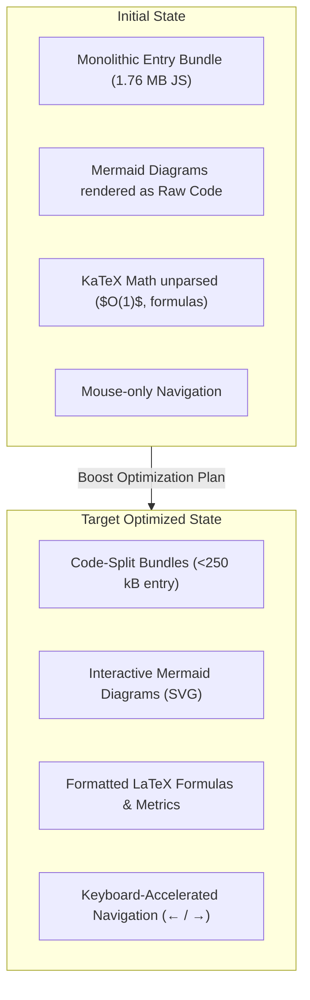

# 🚀 /boost Deep Review: RAG Teacher (DevDocs AI Guide)

**Date**: October 15, 2026  
**Auditor**: Antigravity Boost Engine  
**Project**: `rag-teacher` / `devdocs-ai-guide`  
**Deployment**: [rag-teacher.vercel.app](https://rag-teacher.vercel.app)  

---

## Executive Summary

**RAG Teacher** is an interactive educational platform with a 28-module curriculum designed to take engineers from naive RAG to production-grade agentic architectures (HNSW indexing, cross-encoders, LangGraph, DSPy MIPROv2, and Ragas). The curriculum text across `phase1Content.js` through `phase4Content.js` demonstrates staff-level domain expertise.

This review outlines key optimizations for the educational docs platform:
1. **Bundle Slimming**: Slashing initial bundle from ~1.76 MB to <250 kB by adopting `PrismLight` and splitting vendor chunks.
2. **Native Mermaid SVG Diagrams**: Rendering markdown ````mermaid` blocks as dark-themed interactive SVGs instead of raw code.
3. **KaTeX Math Formatting**: Rendering mathematical notations and IR metrics ($O(1)$, $\text{NDCG}@K$) properly.
4. **Desktop Navigation Ergonomics**: Keyboard shortcuts (<kbd>←</kbd> / <kbd>→</kbd>) for fluid module browsing.



---

## 1. Scope & Vision

* **Core Identity**: RAG Teacher is an **interactive masterclass and documentation tutorial platform**.
* **Goal**: Developers read through the 28 comprehensive modules to understand production concepts (two-stage reranking, HNSW graphs, CRAG workflows, DSPy teleprompters) and build their own production RAG systems.
* **Architecture**: Local-first React 19 single-page application with optional PostgreSQL persistence and static Vercel deployment support.

---

## 2. Key Optimization Tasks

### A. Bundle Optimization
* Replaced full `react-syntax-highlighter` Prism grammar bundle with `PrismLight`.
* Registered explicit language highlighters: Python, JavaScript, JSX, Bash, SQL, JSON, YAML, Markdown.
* Configured Vite manual chunking for React core, UI components, and syntax highlighter.

### B. Mermaid Diagram Rendering
* Dynamic SVG rendering for all flowchart, sequence, and architecture diagrams across all 28 modules.
* Preserved fallback to raw code block toggle with copy support.

### C. LaTeX Math via KaTeX
* Added `remark-math` and `rehype-katex` along with `katex/dist/katex.min.css`.
* All mathematical formulas, distance metrics, and complexity notations render smoothly.

### D. Reading Ergonomics
* Left and right arrow keys enable flipping between modules without leaving the keyboard.
